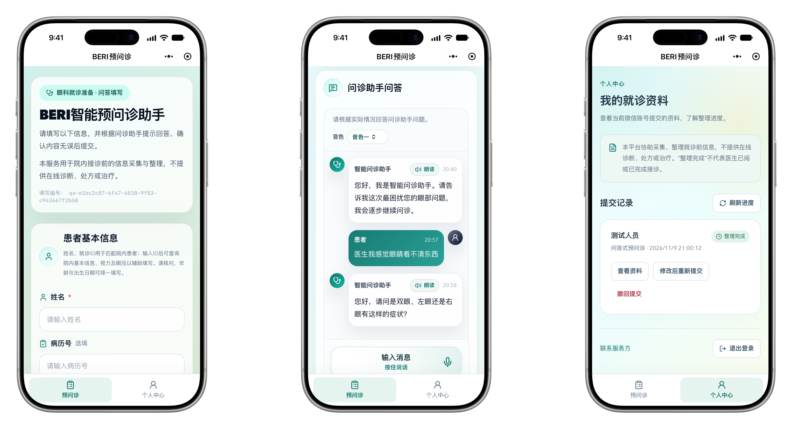
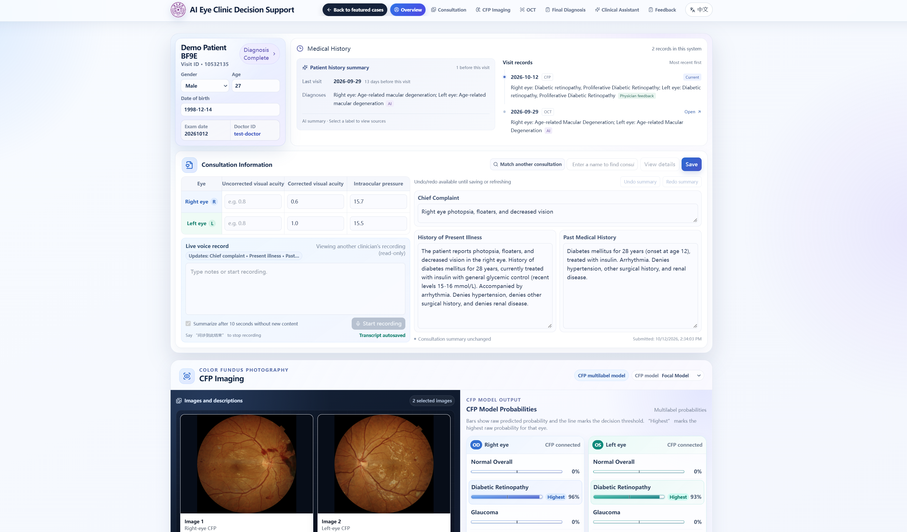
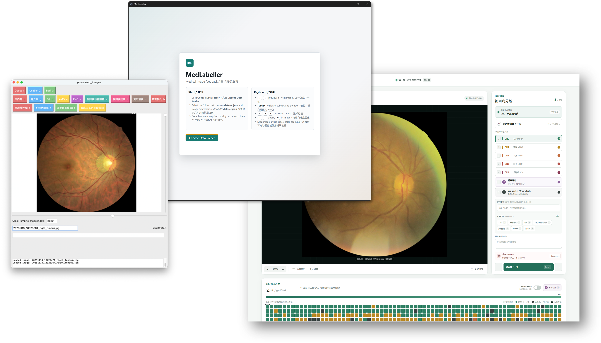

AI-TEC supports the work around an eye-clinic visit. Patients can prepare their history and records before a consultation; clinicians can review examinations alongside AI analysis and document their assessments. In the future, patients will also be able to receive follow-up support through the platform. Companion annotation tools support expert review of medical images for model development.

The initial version was deployed at Beijing Tsinghua Changgung Hospital (BTCH) in November 2025, followed by a deployment at Tiantongyuan North Community Health Service Center (天通苑北社区卫生服务中心) in May 2026. In November 2026, the WeChat mini-program went online, making pre-consultation accessible within WeChat.

## Applications

### Patient pre-consultation

Patients can complete a questionnaire or conversational intake, describe symptoms by text or voice, and upload supporting records. The application organizes this information into a structured history for the consultation.

Built with React and a Flask backend, the web application is also embedded in a WeChat mini-program for easier access. I handled the website and mini-program filing and review processes alongside development.

<figure class="project-figure project-figure--padded project-figure--transparent">

<figcaption>Patient information, conversational intake, and submitted records in the WeChat mini-program.</figcaption>
</figure>

### Clinician workspace

The clinical workspace connects examination records and medical imaging with AI-assisted analysis, including a knowledge graph–enhanced large language model for diagnostic support and recommendations for subsequent care. Clinicians can review findings across visits, record their assessments, and give feedback on model outputs. The community-screening workflow also supports documenting findings and referral advice, with individual or batch examination reports.

The hospital application is built with React and a FastAPI backend. Alongside the clinical software, I developed utilities for retrieving clinical data, synchronizing files between Windows and Linux, and connecting to image-processing services. These companion tools support deployment and day-to-day operation across different clinical environments.

<figure class="project-figure">

<figcaption>An overview of the clinician workspace. It also includes knowledge graph–enhanced LLM support for diagnosis and subsequent care, alongside tools for clinician feedback.</figcaption>
</figure>

### Image annotation and expert review

The annotation applications collect focused expert feedback for improving models on specific tasks and developing new models. Specialists can record labels and observations tailored to each research task. The web application also supports shared annotation projects, task assignments, consistency checks, and revision history.

I built three separate applications using Python/Tkinter, Electron, and React with FastAPI. Working on the same practical problem with different stacks gave me a way to learn each technology and compare their strengths and limitations for local image access, desktop distribution, and shared annotation workflows.

<figure class="project-figure project-figure--padded project-figure--transparent">

<figcaption>Three approaches to medical image annotation: Tkinter, Electron, and a web application built with React and FastAPI.</figcaption>
</figure>

[Related publication: early lessons from AI-TEC →](/publications/ai-agent-eye-clinic)
